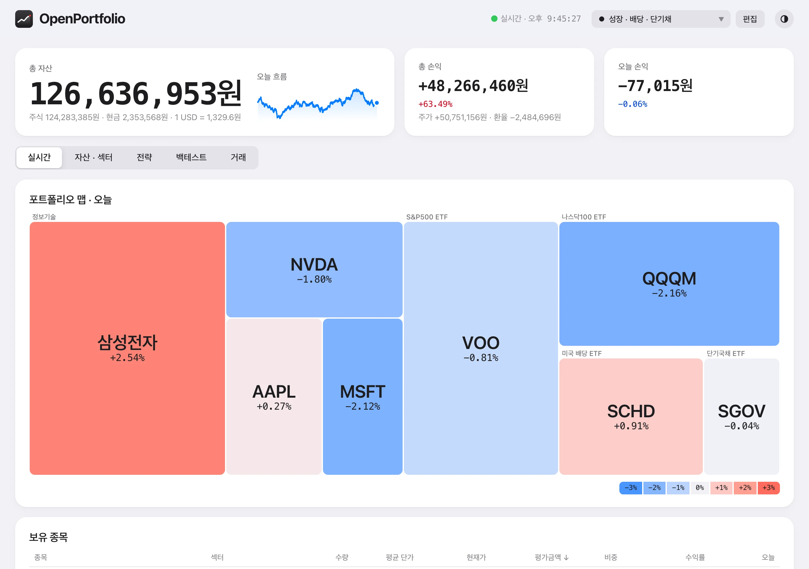

# OpenPortfolio

<br clear="left">

내 컴퓨터에서 돌리는 토스증권 포트폴리오 대시보드. [토스증권 Open API](https://openapi.tossinvest.com) 키 하나로 잔고를 실시간으로 보고, 섹터 노출 · 전략 점검 · 백테스트 · 양도세 추정까지 한 화면에서 한다.

A self-hosted dashboard for Toss Securities (Korea) accounts, built on the official Toss Open API. The UI is in Korean.

<p>
  
  
</p>

화면은 `pnpm demo` 의 가짜 계좌. 설치 · 화면 안내 · 계산 방법은 [문서 사이트](https://openportfolio.github.io/dashboard/).

| 탭          | 보이는 것                                                                                     |
| ----------- | --------------------------------------------------------------------------------------------- |
| 실시간      | 총자산 · 오늘 손익 (체결마다 1초 갱신), 오늘 총자산 흐름, 보유 종목, 종목 차트                |
| 자산 · 섹터 | 자산 구성, 포트폴리오 맵, GICS 섹터 노출 (ETF 는 보유종목까지 펼침), 배당 수입, 섹터 성과     |
| 전략        | 정한 비율 · 하락장 규칙과 지금 보유의 차이, 오늘 살 금액                                      |
| 백테스트    | 매일 적립식으로 전략 · 벤치마크 비교 (원화 · 달러, 배당 재투자, 상장 전은 같은 지수 종목으로) |
| 거래        | 체결 내역, 해외주식 양도세 추정 (선입선출, 연 250만원 공제)                                   |

## 시작하기

필요한 것: Node 24 이상, pnpm (`corepack enable`), 토스증권 Open API 키.

```bash
git clone https://github.com/openportfolio/dashboard && cd dashboard
pnpm install
pnpm dev   # → http://localhost:5280, 처음 열면 토스 키를 넣는 연결 화면
```

키 없이 둘러보려면 `pnpm install && pnpm demo`. 실제 가격으로 지은 가짜 계좌가 뜬다. 브라우저 대신 앱 창으로 쓰려면 `pnpm app` (설치 파일은 `pnpm app:dist`).

키 발급 주의점 · 문제 해결은 [설치와 설정](docs/setup.md).

## 보안

계좌 데이터를 다루므로 밖으로 열지 않는 것이 기본이다.

- API 서버는 `127.0.0.1` 에만 붙고, `Host` 헤더가 localhost 가 아니면 거절한다 (DNS 리바인딩 방어).
- 키는 서버에만 있고 브라우저로 가지 않는다. 쓰기 API 는 전략 저장(JSON) 하나뿐이고 주문 기능은 없다.
- 기록 · 전략 · 체결 내역은 `server/data/portfolio.db` (gitignore) 에 쌓인다.

## 데이터 출처와 한계

- 잔고 · 체결 · 종목 차트: 토스증권 Open API. 주문 내역은 API 로 조회되는 기간(2021-10~)만 있다.
- 백테스트 일봉 · 배당 · 환율: Yahoo Finance 차트 API. **비공식**이라 예고 없이 바뀌거나 막힐 수 있다.
- 섹터 분류: SPDR 섹터 ETF 보유종목(SSGA), ETF 펼침은 SEC EDGAR N-PORT 공시 (분기, 2~4개월 지연).
- 양도세 · 배당 세후 금액은 단순화한 **참고용 추정**이다. 신고는 증권사 자료로 한다.

숫자를 어떻게 셈하는지는 [계산 방법](docs/calculations.md).

## 개발

```bash
pnpm test        # node --test
pnpm typecheck   # TypeScript 7
pnpm lint        # oxlint
pnpm format      # oxfmt
pnpm docs        # 문서 사이트 (VitePress) → http://localhost:5173
```

구조 · 규칙 · 토스 API 주의사항은 [AGENTS.md](AGENTS.md) 에 있다. 국내 종목 섹터처럼 자동 분류가 안 되는 종목은 `server/src/sector/classification.ts` 에 더하면 된다.

[MIT](LICENSE)
