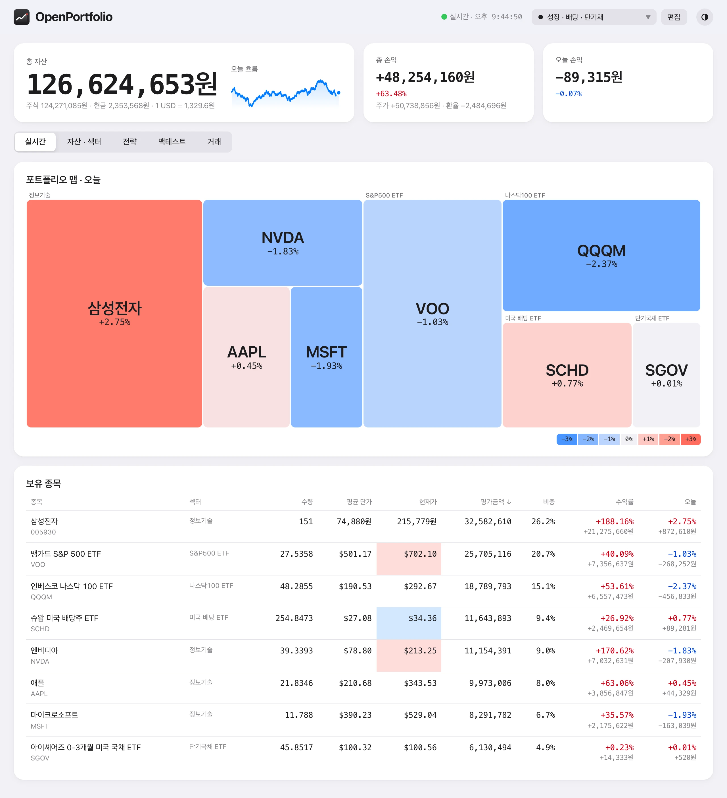
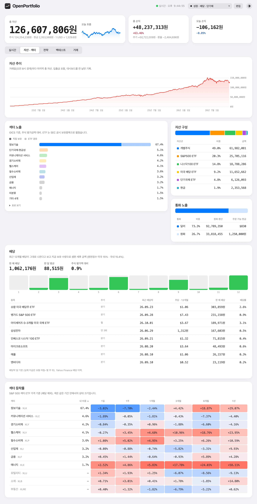
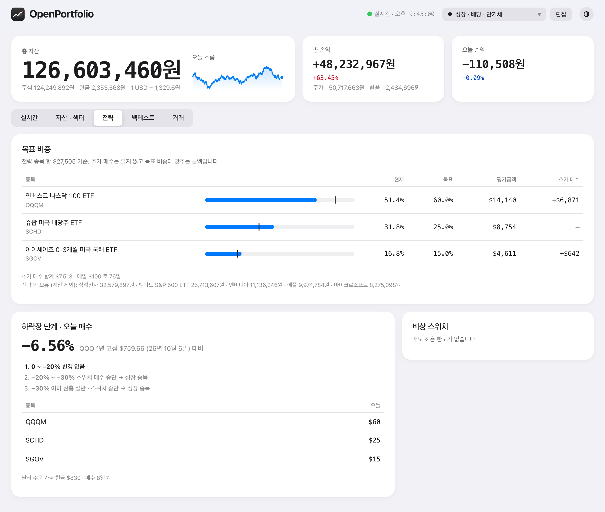
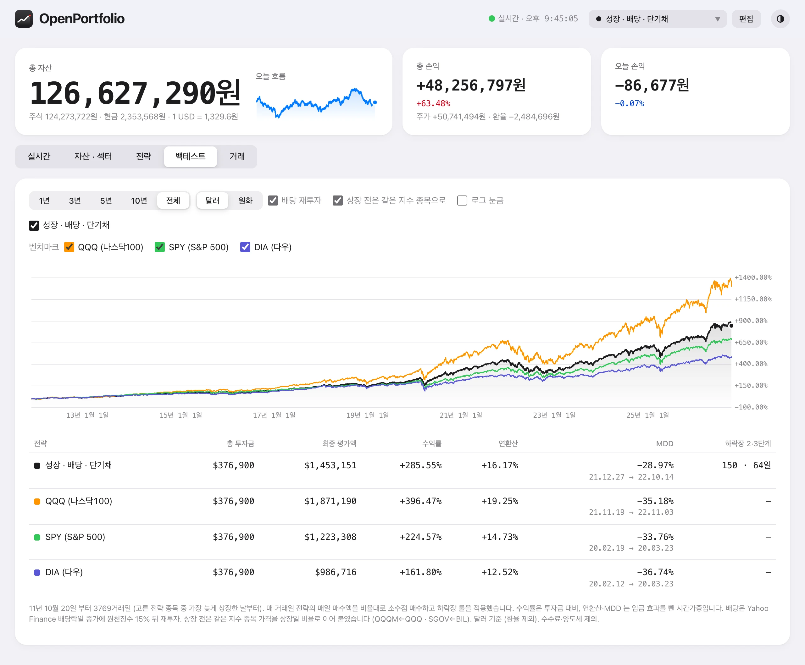
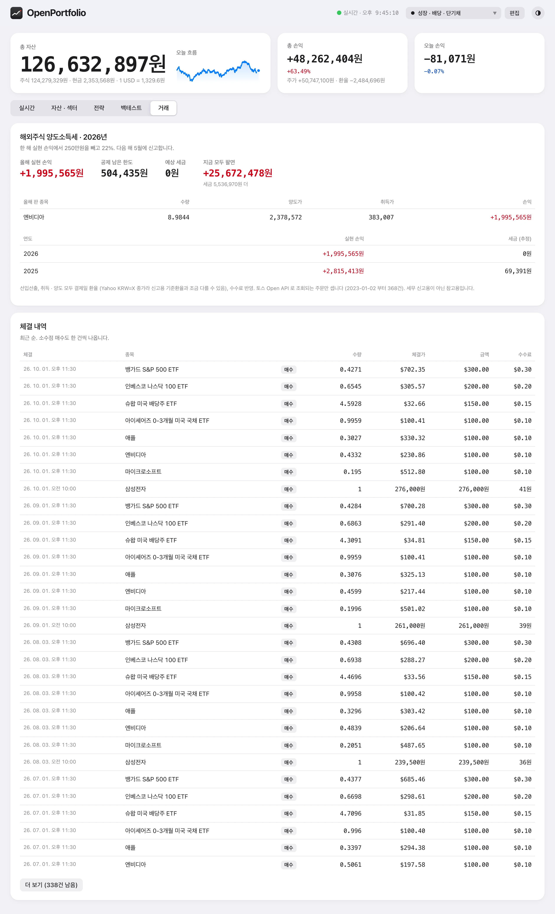
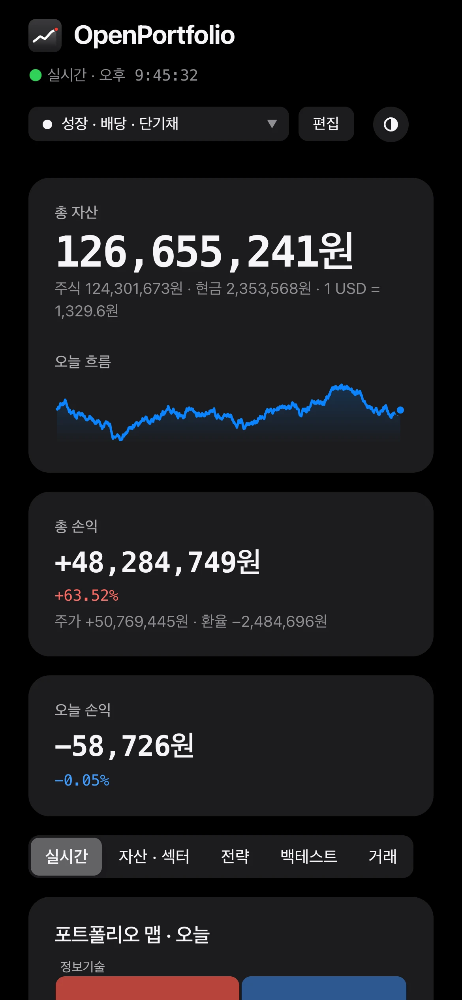

# 화면 안내

스크린샷은 모두 `pnpm demo` 의 가짜 계좌다. 숫자가 어떻게 나오는지는 [계산 방법](calculations.md) 에 있다.

맨 위 세 칸(총 자산 · 총 손익 · 오늘 손익)은 모든 탭에 있다. 토스 실시간 체결이 들어오면 1초 단위로 바뀌고, 수량 · 현금 · 환율은 15초마다 다시 맞춘다. 머리글의 선택 상자는 '지금 따르는 전략', 옆의 '편집' 은 전략 편집 시트, 맨 오른쪽 둥근 버튼은 테마(시스템 설정 → 라이트 → 다크)다.

## 실시간

- **포트폴리오 맵**: 넓이 = 평가금액, 색 = 오늘 등락. 섹터 · ETF 묶음별로 모인다.
- **보유 종목**: 체결가가 바뀐 칸이 잠깐 빨강 · 파랑으로 깜빡인다. 종목을 누르면 당일 · 1년 차트와 평균 단가 선이 열린다.

## 자산 · 섹터

- **자산 추이**: 거래일별 마지막 총자산. 대시보드를 켠 날만 기록되고 입출금도 섞여 있다.
- **섹터 노출**: GICS 11개 섹터. ETF 는 보유종목까지 펼쳐서 더한다 (진한 막대 = 직접 보유, 옅은 막대 = ETF 경유).
- **자산 구성 · 통화 노출**: 개별주식 · ETF 묶음 · 현금, 원화 · 달러 비중.
- **배당**: 최근 12개월 배당이 그대로 나온다고 보고 지금 수량으로 셈한 세후 금액. 막대는 배당락 월.
- **섹터 등락률**: S&P 500 섹터 ETF 의 기간별 가격 등락. 색은 같은 기간 안에서의 상대 크기.

## 전략

전략은 종목별 비율, 하락장 규칙, 매도 허용 한도로 이뤄진다. 처음에는 '지금 보유 비중으로' 나 템플릿(S&P 500 · 나스닥 100 · 성장 · 배당 · 단기채) 중 하나에서 시작하고 편집 시트에서 고친다.

- **목표 비중**: 지금 비중과 목표의 차이. '추가 매수' 는 팔지 않고 목표에 맞추려면 더 사야 할 금액.
- **하락장 단계 · 오늘 매수**: 기준 지수가 1년 고점에서 얼마나 내렸는지로 단계를 정하고, 그 단계의 비중대로 오늘 살 금액을 보여 준다.
- **비상 스위치**: 개별주 하나 · 묶음 합계가 한도를 넘으면 '매도 허용'.

종목마다 하락장 역할이 있다.

| 역할   | 하락장에서                       |
| ------ | -------------------------------- |
| 성장   | 다른 종목이 줄인 몫을 넘겨받는다 |
| 스위치 | 2단계부터 매수를 멈춘다          |
| 완충   | 3단계에서 매수를 절반으로 줄인다 |
| 유지   | 그대로                           |

## 백테스트

체크한 전략과 벤치마크(QQQ · SPY · DIA)를 매 거래일 같은 금액씩 샀다면 어땠을지 비교한다.

- 기간: 1년 ~ 전체 (가장 늦게 상장한 종목의 상장일부터)
- 달러 · 원화 기준, 배당 재투자, 상장 전은 같은 지수 종목으로 잇기, 로그 눈금
- 차트를 끌면 그 구간을 확대하고, 두 번 누르면 돌아온다

## 거래

- **해외주식 양도소득세**: 올해 실현 손익, 250만원 공제 중 남은 한도, 예상 세금, 지금 모두 팔면 얼마가 더 붙는지. 연도별 요약도 있다.
- **체결 내역**: 토스 Open API 로 조회되는 끝난 주문 중 체결분. 최근 순.

## 좁은 화면 · 다크 모드

화면 폭에 맞춰 배치가 바뀌고, 시스템 설정을 따라 다크 모드가 된다.
